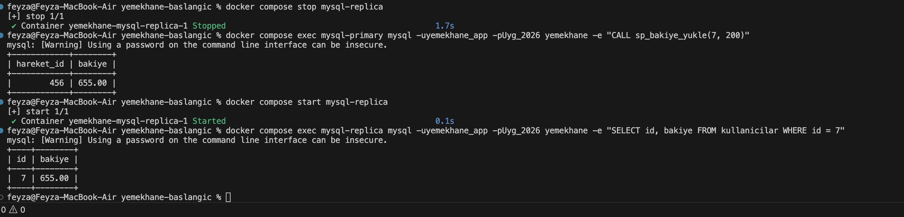

# Yemekhane Otomasyonu – Dönem Ödevi Raporu

**Öğrenci:** Feyza Doğmuş · **No:** 241229085
**Aşama 2 için seçilen yol:** MVC (Node.js / Express + EJS)

---

## Aşama 1 · Altyapı

### 1.1 Servislerin durumu

```
docker compose up -d
docker compose ps -a
```

Dört servis `healthy`, `replica-setup` `Exited (0)` durumundadır.


Başlangıç sayfası `http://localhost:8080` adresinde açılmıştır.


### 1.2 Replikasyon durumu

```
docker compose exec mysql-replica mysql -uroot -pyemekhane_kok -e "SHOW REPLICA STATUS\G" | grep -E "Source_Host|Replica_IO_Running|Replica_SQL_Running"
```

`Replica_IO_Running: Yes` ve `Replica_SQL_Running: Yes`.


### 1.3 Kaynakta yazma, replikada okuma

Replikada kullanıcı 7'nin bakiyesi 355.00 idi. Kaynakta 100 TL yüklendi, replikada bakiye 455.00 oldu.

```
docker compose exec mysql-replica mysql -uyemekhane_app -pUyg_2026 yemekhane -e "SELECT id, bakiye FROM kullanicilar WHERE id = 7"
docker compose exec mysql-primary mysql -uyemekhane_app -pUyg_2026 yemekhane -e "CALL sp_bakiye_yukle(7, 100)"
docker compose exec mysql-replica mysql -uyemekhane_app -pUyg_2026 yemekhane -e "SELECT id, bakiye FROM kullanicilar WHERE id = 7"
```


### 1.4 Replikaya yazma denemesi reddedilir

```
docker compose exec mysql-replica mysql -uyemekhane_app -pUyg_2026 yemekhane -e "CALL sp_bakiye_yukle(7, 50)"
```

`ERROR 1290` döndü, bakiye 455.00 olarak kaldı.


### 1.5 Replika durup başlayınca değişiklikleri yakalar

```
docker compose stop mysql-replica
docker compose exec mysql-primary mysql -uyemekhane_app -pUyg_2026 yemekhane -e "CALL sp_bakiye_yukle(7, 200)"
docker compose start mysql-replica
docker compose exec mysql-replica mysql -uyemekhane_app -pUyg_2026 yemekhane -e "SELECT id, bakiye FROM kullanicilar WHERE id = 7"
```

Replika kapalıyken kaynakta yapılan 200 TL yükleme, replika başlayınca yakalandı (bakiye 655.00).



### 1.6 Redis

```
docker compose exec redis redis-cli ping
```


### 1.7 Son durum

Bu testlerden sonra tüm servisler hâlâ sağlıklıdır.

